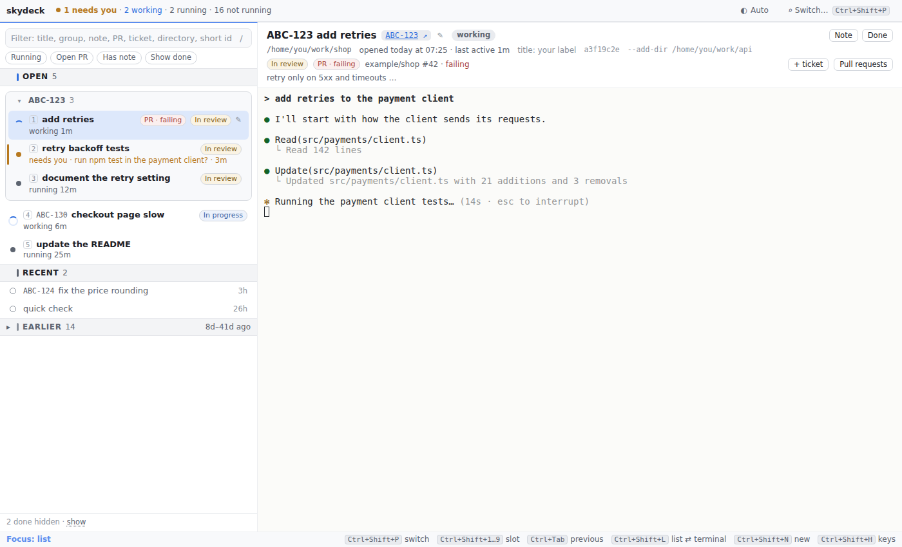

# skydeck

skydeck is a window and a command line for Claude Code, made for people who run many sessions at
once. It shows which session is about what, what each one is doing and which one needs you, each
with your label, group, note, ticket and pull requests. A restart of the PC or of WSL ends every
open session; skydeck offers to bring them back, each with the flags it was started with.

AI agents asked to install or change skydeck read [AGENTS.md](AGENTS.md) first.



## What you need

- Windows with WSL2, and Microsoft Edge on the Windows side, for the window.
- Inside WSL: Node.js 24.12 or newer, `git`, Claude Code (installed inside WSL and started once),
  and python3 3.9 or newer for the window's terminals.
- `gh`, logged in, only for the status of pull requests and of GitHub issues.
- On plain Linux the command line works alone, without the window. macOS is not supported yet.

## Install

```sh
git clone https://github.com/vojtahavranek/skydeck.git ~/skydeck
cd ~/skydeck
bin/skydeck install
```

Then, in a new terminal of your own (not a `!` command inside Claude Code), run `skydeck window`.
The [quick start](docs/quick-start.md) explains the questions install asks, and your first ten
minutes in the window.

## What skydeck reads and keeps

- It reads Claude Code's transcripts and live-session files for each session's folder, title,
  times, state and pull-request links, never writes to them, and keeps no conversation text.
- It adds two hooks to Claude Code's settings and, after your yes, one setting in `~/.claude.json`.
- Its database, `~/.local/share/skydeck/skydeck.db`, keeps each session's launch flags with their
  values, so a text given to `--system-prompt` or `--append-system-prompt` is in it, and in the
  copies of it kept beside it before an upgrade (the newest three). The prompt
  given as `claude`'s argument is not: it waits in the spool (`~/.local/state/skydeck/spool/`) only
  until skydeck reads it in, or up to seven days if that file cannot be read.
- Its logs (`~/.local/state/skydeck/*.log`) hold no prompt.
- Network: only `gh`, `skydeck update`'s `git fetch` and your ticket-status programs. No telemetry.
- The window is a local page (127.0.0.1) served from WSL; it types into your sessions as a terminal,
  and ends a session of the window only when you ask it to (Done's dialog).

## Documents

- [docs/quick-start.md](docs/quick-start.md): from nothing to using skydeck, in about ten minutes.
- [docs/install.md](docs/install.md): the complete guide and reference.
- [docs/design.md](docs/design.md) and [docs/design-step-2.md](docs/design-step-2.md): the design
  of the commands and of the window.
- [docs/manual-checks.md](docs/manual-checks.md): the maintainer's checklist, run by hand after
  changes; not a guide.

## Commands

| Command                                                                                           | Effect                                                                                                                                                                                                                                                               |
| ------------------------------------------------------------------------------------------------- | -------------------------------------------------------------------------------------------------------------------------------------------------------------------------------------------------------------------------------------------------------------------- |
| `skydeck`                                                                                         | The interactive list on a terminal; otherwise the same as `skydeck ls`.                                                                                                                                                                                              |
| `skydeck ls [--all] [--json] [--refresh]`                                                         | Print the list. `--all` includes sessions marked done; `--json` prints stable, versioned JSON; `--refresh` first reads the status of the pull requests that are not merged or closed (`gh`).                                                                         |
| `skydeck show <ref> [--json] [--refresh]`                                                         | One session: state, marks, ticket, project directory, launch command, links, note, pull requests, holders.                                                                                                                                                           |
| `skydeck label <ref> [<text>]` / `skydeck group <ref> [<text>]`                                   | Set. Without text, clear. The text is all the arguments after `<ref>`, joined by one space.                                                                                                                                                                          |
| `skydeck note <ref> [--set <text>]`                                                               | Edit in `$VISUAL`, else `$EDITOR`, else `vi`; or set directly (`--set ''` clears).                                                                                                                                                                                   |
| `skydeck ticket set <ref> <link-or-key>` / `skydeck ticket clear <ref>`                           | Set the session's one ticket from a whole `http`/`https` link, or a key like `ABC-123` that `ticketUrl` turns into its link (the address is stored); remove it.                                                                                                      |
| `skydeck done <ref>` / `skydeck undone <ref>`                                                     | Hide / show. Never stops a process.                                                                                                                                                                                                                                  |
| `skydeck pr add <ref> <url>` / `skydeck pr rm <ref> <url>` / `skydeck pr refresh`                 | Attach and read the status now / detach / read the status of every pull request that is not merged or closed.                                                                                                                                                        |
| `skydeck new [--label <text>] [--group <text>] [--here \| --tab \| --window] [-- <claude flags>]` | Start a new session in the current directory, with a label and a group from the start; `--window` starts it in the skydeck window (its server must run).                                                                                                             |
| `skydeck resume <ref> [--here \| --tab \| --window]`                                              | Resume a session that is not running, in its own directory and with the flags it was started with; `--window` resumes it in the skydeck window (its server must run).                                                                                                |
| `skydeck restore [--all] [--dry-run] [--yes]`                                                     | Bring back what was open before the last restart.                                                                                                                                                                                                                    |
| `skydeck install` / `skydeck uninstall [--purge]` / `skydeck doctor`                              | Set up, undo and check the installation.                                                                                                                                                                                                                             |
| `skydeck window [--print-url] [--new-window] [--restart] [--stop] [--new-secret]`                 | Open the window: start its server when none runs, and an Edge window when none is open. `--print-url` prints an address for any browser instead; `--restart` and `--stop` restart or stop the server (sessions keep running); `--new-secret` replaces skydeck's key. |
| `skydeck update [--check]`                                                                        | Bring this checkout up to date (`git fetch`, then a fast-forward of its branch) and restart the window's server for the new code: the window stays open and reloads itself, sessions keep running. `--check` only lists the new commits.                             |
| `skydeck serve [--foreground]`                                                                    | The window's server, started by `skydeck window`; `--foreground` runs it in the terminal, logging to stderr, for debugging.                                                                                                                                          |

`skydeck --help` lists the commands, `skydeck <command> --help` shows the options of one, and
`skydeck --version` prints the version.

`<ref>` is a full session id, a unique id prefix of at least 4 characters, or a label equal to the
text. More than one match is an error that lists the candidates; no match is an error too (both
exit 3).

Exit codes: 0 success; 1 failure, or `doctor` found a problem; 2 usage error; 3 reference not found
or ambiguous; 4 resume refused; 5 restore stopped before finishing. Also: 141 when a write to
standard output failed because its reader had closed it (`skydeck doctor | head -1`) and the command
had succeeded; 127 when the launcher finds no `node`; and once `resume`, `new` or `restore` has handed the terminal to `claude`, the status
is `claude`'s own.

In the interactive list: `j`/`k` or the arrows move, `Enter` shows the detail, `l` label, `g` group,
`n` note, `t` ticket, `d` done or undo, `p` pull requests, `R` resume, `/` filter, `a` show all,
`r` refresh, `q` quit. The list refreshes itself every 5 seconds without reordering the rows (the cursor
moves only when its own session leaves the list, and the last line says so); the title line counts the sessions per state; `r` refreshes at once, reorders, and reads the
pull requests again.

## Is it tied to WezTerm?

No. The commands work in any terminal, and the window has terminals of its own. WezTerm adds one
thing: new tabs (`--tab`, or `"terminal": "wezterm"` in `config.json`), which `restore` uses to
bring several sessions back at once. Details are at the top of [docs/install.md](docs/install.md).

## Development

Needs Node.js 24.12 or newer. TypeScript runs directly through Node's type stripping, so there is
no build step.

```sh
npm ci
npm run check      # format check, type check, the tests, then the page tests
npm test           # the tests only
npm run test:page  # the page tests only (web/, in headless Chromium)
npm run format     # rewrite files with Prettier
```

The page tests need Playwright's Chromium in `~/.cache/ms-playwright` (Playwright is pinned to
1.60.0, whose Chromium is build 1223). When they say `Chromium for Playwright is not installed`,
download it once, without `sudo`:

```sh
npx playwright install chromium
```

Run the CLI from a checkout with `bin/skydeck --help`. If the `node` on your `PATH` is older than
24.12, point skydeck at a newer binary with `SKYDECK_NODE=/path/to/node`.

A command is one file, `src/cli/commands/<name>.ts`, that exports `command` (see
`src/cli/command.ts`); adding one does not edit any shared file. Tests mirror the source tree under
`test/`, and use the helpers in `test/helpers/`, which give every child process a temporary `HOME`
and `SKYDECK_HOME`.

The design is in [docs/design.md](docs/design.md).

## Licence

skydeck is MIT-licensed ([LICENSE](LICENSE)); the vendored xterm.js files keep their own licences,
and [vendor/xterm/THIRD-PARTY-NOTICES](vendor/xterm/THIRD-PARTY-NOTICES) names the code they bundle.
