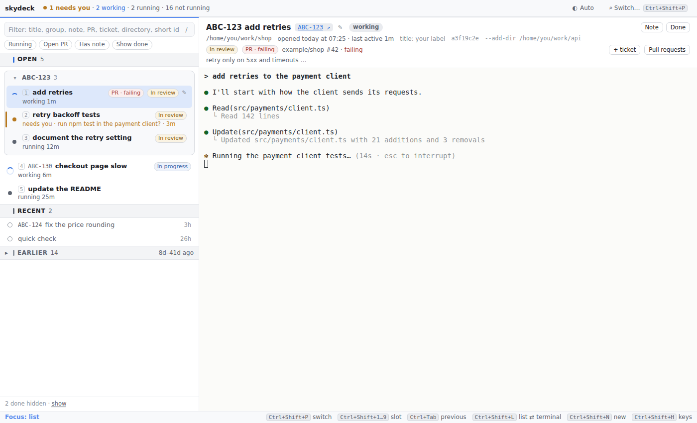
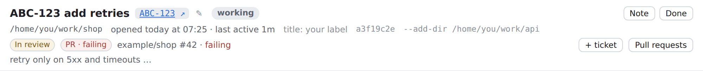
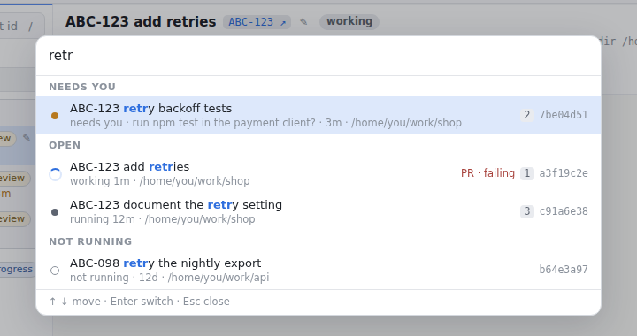
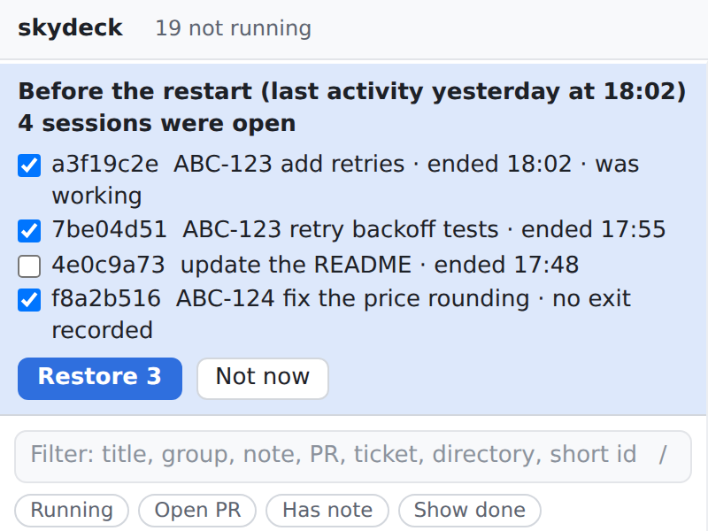

# Quick start

This takes you from nothing to working in skydeck's window, in about ten minutes. Every command
below runs inside WSL. The complete guide is [install.md](install.md).

## What you need

- Windows with WSL2 (Ubuntu), and Microsoft Edge on the Windows side.
- Inside WSL: Node.js 24.12 or newer (`node --version`), `git`, and python3 3.9 or newer
  (`python3 --version`) for the window's terminals.
- Claude Code, installed inside WSL and started once, so that `~/.claude` exists: skydeck sees
  only the sessions of the Claude Code inside WSL.
- `gh`, logged in (`gh auth status`), only for the status of pull requests and GitHub issues.

Missing one? [On a fresh WSL](install.md#on-a-fresh-wsl), in the guide, has the commands.

## Install

```sh
git clone https://github.com/vojtahavranek/skydeck.git ~/skydeck
cd ~/skydeck
bin/skydeck install
```

Leave the folder where it is: the install links to it. If `bin/skydeck` says that it needs a newer
Node.js, put the path of a newer `node` in front: `SKYDECK_NODE=/path/to/node bin/skydeck install`.

The install adds two hooks to Claude Code's settings file, `~/.claude/settings.json`, which tell
skydeck when a session starts and when it ends. It shows you the exact entries first, and keeps a
copy of the file as it was. It asks up to three questions; Enter alone answers no, and a no to the
first one ends the install with nothing changed.

1. **Add them?** Yes adds the two hooks, so that skydeck records every session that starts.
2. **Mark … sessions older than 7 days as done?** (asked once, when there are such sessions) Yes
   hides them from the list, without stopping or deleting anything.
3. **Turn the shortcut off?** (asked while it is on) Yes turns off, in `~/.claude.json`, Claude
   Code's ← shortcut (← on an empty prompt sends the session to the background), so that a ← meant
   for skydeck's list cannot send a session away.

To undo the install, run `skydeck uninstall`: it takes the two hooks out again, removes its links
and stops the window's server. Your database stays, sessions that run keep running, and the ←
shortcut stays as you set it.

## Check the install

Open a new terminal, so that `skydeck` is found (the install links it into `~/.local/bin`; when a
new terminal does not find it, add `export PATH="$HOME/.local/bin:$PATH"` to `~/.bashrc` and open
one more), and run:

```sh
skydeck doctor
```

It prints one line per check, each starting with `ok`, `info` or `problem`, and most `problem`
lines say what to do. Two things are normal on a new machine: `doctor` has seen no events yet (that
changes once a session starts), and without `gh` logged in, its `gh` line is a `problem`.
`skydeck ls` prints your sessions, also those Claude Code had before the install; one that never
had a prompt shows only while it runs.

## Open the window

In a WSL terminal of your own (not with `!` inside Claude Code, where it refuses):

```sh
skydeck window
```

It starts skydeck's server in the background and opens an Edge window. Run it from a plain shell:
every session in the window gets the environment of the shell that started the server (a Python
virtual environment, `direnv` or an `AWS_PROFILE` included). You can close the terminal: the
server runs on its own. Closing the window ends nothing either: the sessions keep running, and
`skydeck window` opens it again. Try it first with a new session in a scratch folder, before you
resume real work into it.



## Your first ten minutes in the window

The keyboard is either in the list or in the terminal. The key bar at the bottom says which
(`Focus: list` or `Focus: terminal`), and **Ctrl+Shift+L** moves it. The list's own keys, such as
`l` or `d`, work while it says `Focus: list`. **Ctrl+Shift+H** shows every key. While there is no
session at all yet, the list says so and names the two ways to get one: start `claude` in any
terminal, or press Ctrl+Shift+N in the window.

### Read the list

The list has three sections:

- **Open**: the sessions that run, in the window or in another terminal. The small number 1–9 of a
  session in the window is its slot: Ctrl+Shift+1…9 jumps to it.
- **Recent**: the sessions that do not run and were active in the last 7 days.
- **Earlier**: the older ones, folded. Click its band to unfold it.

A running session's second line says what it does: `working` (Claude Code is busy), `waiting` (it
waits for you, at its prompt or on a question such as a permission) or `running` (it runs and
reports nothing more); one that runs in another terminal says `running in another terminal`, and
one that Claude Code runs in its background says `running in Claude Code's background`. A hollow
ring marks a session that does not run; a red diamond and the mark `crashed` (or `crashed
mid-turn`), one that ended unexpectedly. Point at a mark to read what it means. Two or more
sessions of one group sit together in a block: click the group's name to close or open it. The
title bar counts the sessions in each state.

### Open a session's terminal

Click a session under Open. Its terminal shows on the right, and what you type goes to Claude
Code. Ctrl+Shift+C copies from the terminal (Ctrl+C interrupts Claude Code, as always), Ctrl+V
pastes text. A session that runs in another terminal cannot be shown here: once you `/exit` it
there, you can resume it in the window.

### Start a new session

Press **Ctrl+Shift+N**. The form "New session" asks for a Directory (a full path such as
`/home/you/work/shop`; it starts with the folder of the selected session), an optional Label and
Group, and Flags for claude. **Start** opens it in the window.

### Bring an old session back

Click a session under Recent (or under Earlier, once unfolded). The right side shows the command it
will run. **Resume here**, Enter or a double click resumes it in the window, in its own folder and
with the flags it was started with (for a session that began before you installed skydeck, they
are not known, and the right side says so). A single click never resumes anything.

### Give it a label, a group and a note

Select the session. With the keyboard in the list, press `l` for its label, `g` for its group and
`n` for its note. Or use the session's header, at the top of the right side: click the title, the
✎ beside the group (**+ group** when it has none), or **Note**. Enter saves (in a note,
Ctrl+Enter), Esc closes; an empty field clears the label or the group.

The label is shown as the session's title, and Claude Code gets it as the session's name at its
next start. The group is, by default, the ticket key at the start of the title, such as `ABC-123`.



### Mark it done, and find it again

Press `d`, or **Done** in the header. The session leaves the list (a running one stays under Open
until it ends), and a message with **Undo** shows for 5 seconds. Done deletes nothing. For a
session running in the window it asks first: **End session and mark done** ends that `claude` as
closing its terminal would, **Mark done, keep it running** (where the keyboard starts) only
marks it done. The list's footer counts the hidden ones (`2 done hidden · show`): **show**, `a` or the
switch **Show done** lists them again, and `d` (or **Undone** in the header) on one of them takes
the mark away. A done session that gets new activity comes back by itself.

### Attach a pull request and a ticket

The pull requests a session touched are attached by themselves. To attach one yourself, press `p`
(or **+ PR**, or **Pull requests**, in the header), paste its whole link, such as
`https://github.com/example/shop/pull/42`, and press **Attach**. The chip shows the status, read
with `gh`: `PR · failing`, `PR · review`, `PR · approved` and so on.

For the ticket, press `t` (or **+ ticket** in the header) and paste its link. A key alone, such as
`ABC-123`, works once `~/.config/skydeck/config.json` says how a key becomes a link, for example
`{ "ticketUrl": "https://tickets.example.com/browse/{key}" }`, and you have run
`skydeck window --restart`. The ticket's status shows as a chip when the ticket is a GitHub issue,
or when you name a program that reads it (the guide's
[A ticket's status](install.md#a-tickets-status)).

### Find a session

Press `/` (with the keyboard in the list) or click the filter at the top of the list, and type.
Every word must match: the title, the group, the note, the folder, a pull request, the ticket, or
the start of the short id (at least 4 characters). The chips under it narrow the list: **Running**,
**Open PR**, **Has note**, **Done**. The first three list no done session unless **Show done**,
the switch at the end of their row, is on; **Done** lists only the done ones; typed words find done
sessions too. Esc clears the words.

**Ctrl+Shift+P**, or **Switch…** in the title bar, opens the quick switcher over every session,
done ones too. Type a few letters, move with ↑ ↓ and press Enter: it switches to a running session,
and resumes one that does not run.



### Go to the session that needs you

A session needs you when Claude Code asks you something (a permission, a question), when its turn
finished while you were not looking, or when its terminal in the window ended unexpectedly. Its row
gets a coloured bar and a line that says why, and the title bar and the taskbar count them.
**Ctrl+Shift+J** goes to the next one; press it again for the one after. **Turn on notifications**
in the title bar (it shows until you have answered Edge's question) lets Edge show a desktop
notification when a session starts to need you while no skydeck window has the focus.

## After a restart of the PC or of WSL

A restart ends every session that was running. Afterwards, open a WSL terminal and run
`skydeck window`. At the top of the list the window offers the sessions that were open ("Before the
restart … sessions were open"), with a check box each; the ones the restart cut off are ticked.
**Restore 3** (its number counts the ticked ones) resumes them in the window, a few at a time.
**Not now** hides the offer; until the next restart, typing `>restore` in the quick switcher still
offers it. Without the window, `skydeck restore` in a terminal resumes the first session there and
prints a command for each of the others (with `"terminal": "wezterm"` in `config.json`, it opens a
WezTerm tab for each).



## Keeping WSL running

WSL stops by itself 15 seconds after its last terminal (or other `wsl.exe`) has ended, and every
session in the window ends with it. While the window's server or a session in it runs, skydeck
keeps WSL running with a hidden `wsl.exe`, and `skydeck doctor` says whether it runs. WSL's own
setting `instanceIdleTimeout=-1` does the same without skydeck: see the guide's
[Keeping WSL running](install.md#keeping-wsl-running).

## Updating

In a WSL terminal of your own, `skydeck update --check` lists what is new, and `skydeck update`
brings `~/skydeck` up to date. When the window is open, it restarts the window's server and the
window reloads itself; otherwise run `skydeck window` afterwards. Your sessions keep running. It
needs a checkout without changes of your own, and it refuses inside Claude Code (`--check` works
there).

## The words skydeck uses

- **session**: one Claude Code conversation, with its id and its transcript.
- **state**: what a session's program does now: working, waiting, running, or not running.
- **needs you**: the session asks you something, finished a turn you have not seen, or its
  terminal in the window ended unexpectedly.
- **label**: your name for a session, shown as its title.
- **group**: a ticket key or a topic, by default the ticket key at the start of the title.
- **note**: free text on one session, kept on this machine.
- **done**: a mark that hides a session from the list; it stops nothing (unless you choose **End
  session and mark done** for a session running in the window).
- **ticket**: one link per session, to its ticket, which can show the ticket's status.
- **pull-request chip**: the status of a session's open pull requests, read with `gh`.
- **restore**: bringing back, after a restart, the sessions that were open before it.

## When something looks wrong

1. Run `skydeck doctor` in a WSL terminal. Most `problem` lines say what to do.
2. Look at skydeck's logs in `~/.local/state/skydeck/`: `hook.log` (the hook's errors),
   `server.log` and `keepers.log` (the window's). They hold no conversation content.
3. The guide's last section, [If something goes wrong](install.md#if-something-goes-wrong), lists
   messages and what to do about each.
